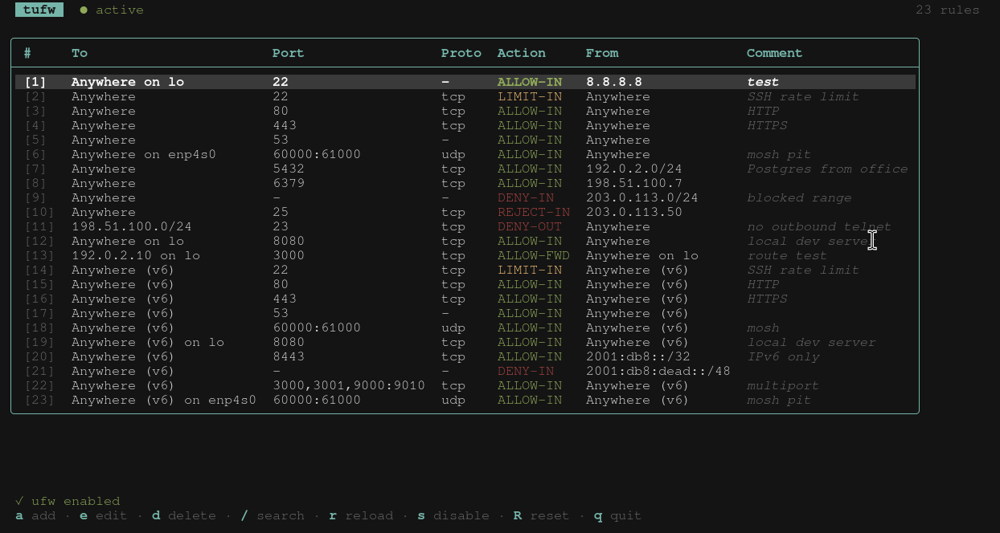

[](https://goreportcard.com/report/github.com/peltho/tufw)

# Terminal UI for ufw
This go package provides a terminal user interface for `ufw`.



It allows you to add, edit or remove rules in a fancy way which is ideal when you're not familiar with `ufw` command.

> Be sure to run it as root otherwise it won't work.

## Usage
```
sudo tufw [-color cyan|red|green|blue] [-log tufw.log]
```

| Key | Action |
| --- | --- |
| `↑`/`↓`, `j`/`k`, `g`/`G` | Move through the rules |
| `a` | Add a rule |
| `e` / `enter` | Edit the selected rule |
| `d` | Delete the selected rule |
| `/` | Filter rules (regex), `esc` clears the filter |
| `r` | Reload rules |
| `s` | Disable ufw |
| `R` | Reset all rules |
| `q` | Quit |

Rules are read from ufw's own rule files (`user.rules` / `user6.rules`). Before deleting or editing a rule by its number, tufw checks that its numbering still matches `ufw status numbered`.

## Installation
Just head over the [releases](https://github.com/peltho/tufw/releases) page and install it manually with your favorite package manager.

For instance: ```sudo apt install tufw_0.1.0_linux_amd64.deb```

You can also find this package on **AUR** for archlinux users: ```yaourt -S tufw-git```

## Dependencies
This package is based on [Bubble Tea](https://github.com/charmbracelet/bubbletea), [Huh](https://github.com/charmbracelet/huh) and [Lip Gloss](https://github.com/charmbracelet/lipgloss). Building from source requires Go 1.26+.

## Troubleshooting
Add your issue here on Github if you spot an unwanted behavior.
Feel free to get in touch if you have any questions.

## Licence
[MIT](https://github.com/peltho/tufw/blob/main/LICENSE.txt)
